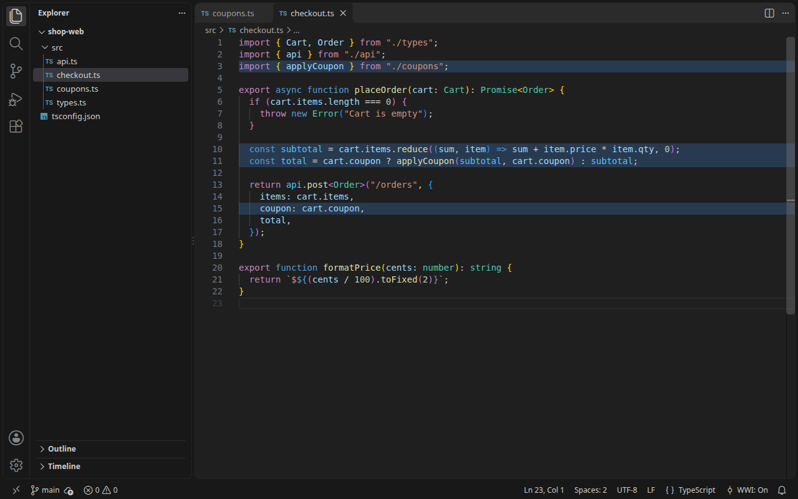
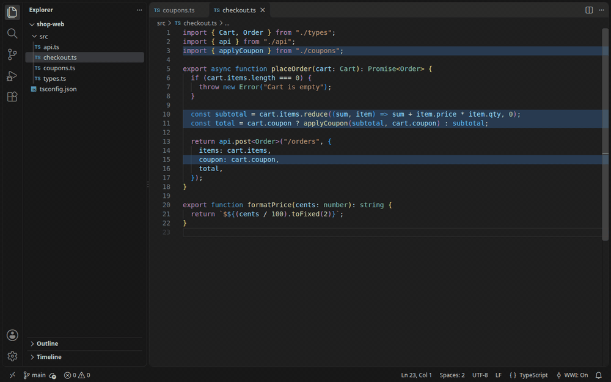

# Where Was I?

[](LICENSE)

"Where Was I?" is a Visual Studio Code extension that helps you quickly identify recent code changes by visualizing the latest git commit differences using soft background gradients directly in your editor.

It's perfect for jumping back into a project and instantly seeing what you (or others) were last working on.



## Features

- **Inline Git Highlights**: Visually highlights lines modified in the most recent commit for the currently open file.
- **Customizable Colors**: Choose from multiple preset highlight colors (Ocean Blue, Mint Green, Amber, Rose, Violet) to suit your theme.
- **Filter by Author**: By default, only changes made by others are highlighted: a file whose latest commit is yours shows no highlights. Turn on "Show Yours" to highlight your own latest commits too.
- **Status Bar Integration**: Provides a convenient status bar item indicating whether highlights are currently enabled or disabled.
- **Quick Settings Menu**: Click the status bar item to open a quick-access popup menu where you can show/hide highlights, show/hide your own commits, or change the highlight color on the fly.
- **Keyboard Shortcut**: Press `Ctrl+Alt+W` to instantly toggle highlights on/off from anywhere in the editor, with a brief status bar confirmation.

## Usage

Open any file in a git repository: the lines changed in that file's latest commit are highlighted. Click **WWI: On** in the status bar for the settings menu, where you can change the highlight color, and press `Ctrl+Alt+W` to turn the highlights off and on.



## Extension Settings

This extension contributes the following configurable settings:

- `whereWasI.showDiffChanges`: Enable or disable the highlighting of recent git changes globally. (Default: `true`)
- `whereWasI.diffColor`: Select the soft background color used for highlighting changed lines. (Default: `#3f79c5` - Ocean Blue)
- `whereWasI.showYours`: When disabled, files whose latest commit was authored by you (your configured git `user.name`) are not highlighted. Enable it to highlight your own commits too. (Default: `false`)

## Keyboard Shortcuts

| Shortcut     | Action                             |
| ------------ | ---------------------------------- |
| `Ctrl+Alt+W` | Toggle highlight visibility on/off |

## Commands

- `Where Was I: Settings Menu` (`whereWasI.showInfoPopup`): Opens the interactive settings menu to show/hide highlights, show/hide your own commits, or change the highlight color.
- `Where Was I: Toggle Highlights` (`whereWasI.toggleHighlights`): Directly toggles the `showDiffChanges` setting on/off. Also accessible via `Ctrl+Alt+W`.

## Requirements

- **Git**: The extension relies on the `git` command-line tool being installed and accessible in your system's PATH. It functions by analyzing the local git history of your repository workspace.

## Installation

Install **Where Was I?** from the [VS Code Marketplace](https://marketplace.visualstudio.com/items?itemName=rajan694.where-was-i) or [Open VSX](https://open-vsx.org/extension/rajan694/where-was-i).

To install a specific version, download its `.vsix` file from the [GitHub releases](https://github.com/Rajan694/Git-Commit-Code-Visualizer/releases), then in VS Code open the Extensions view, click `...` and choose **Install from VSIX...**, or run:

```bash
code --install-extension where-was-i-X.Y.Z.vsix
```

## Release Notes

See [CHANGELOG.md](CHANGELOG.md).

## License

[MIT](LICENSE)
